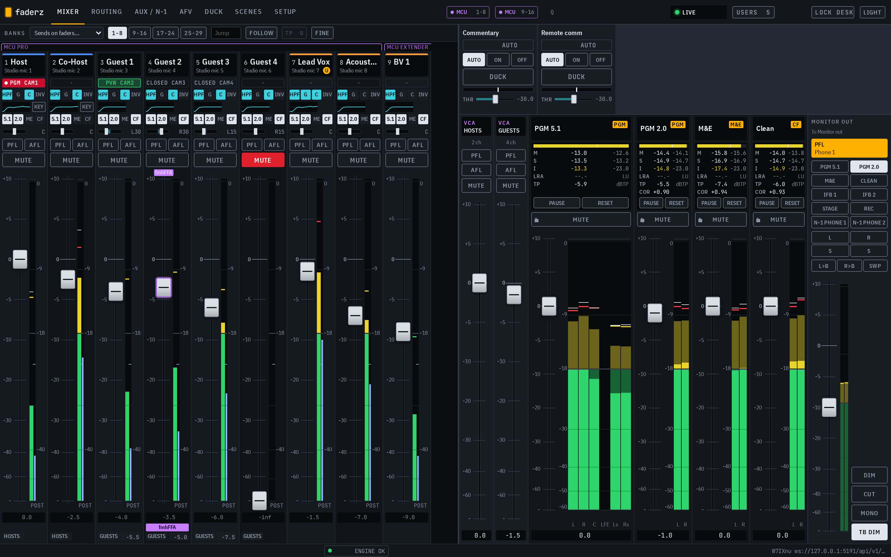
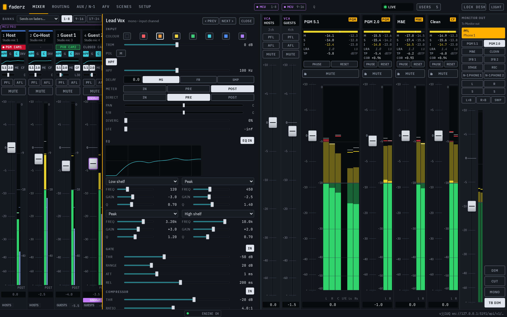
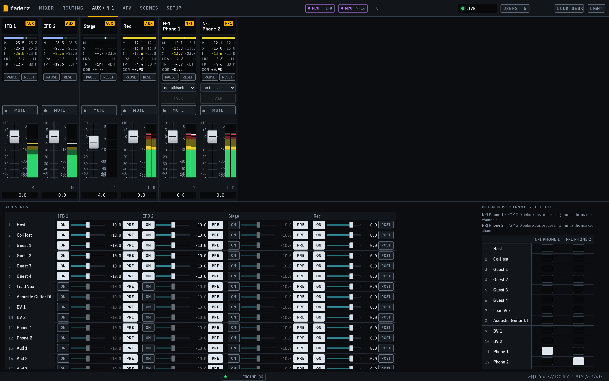
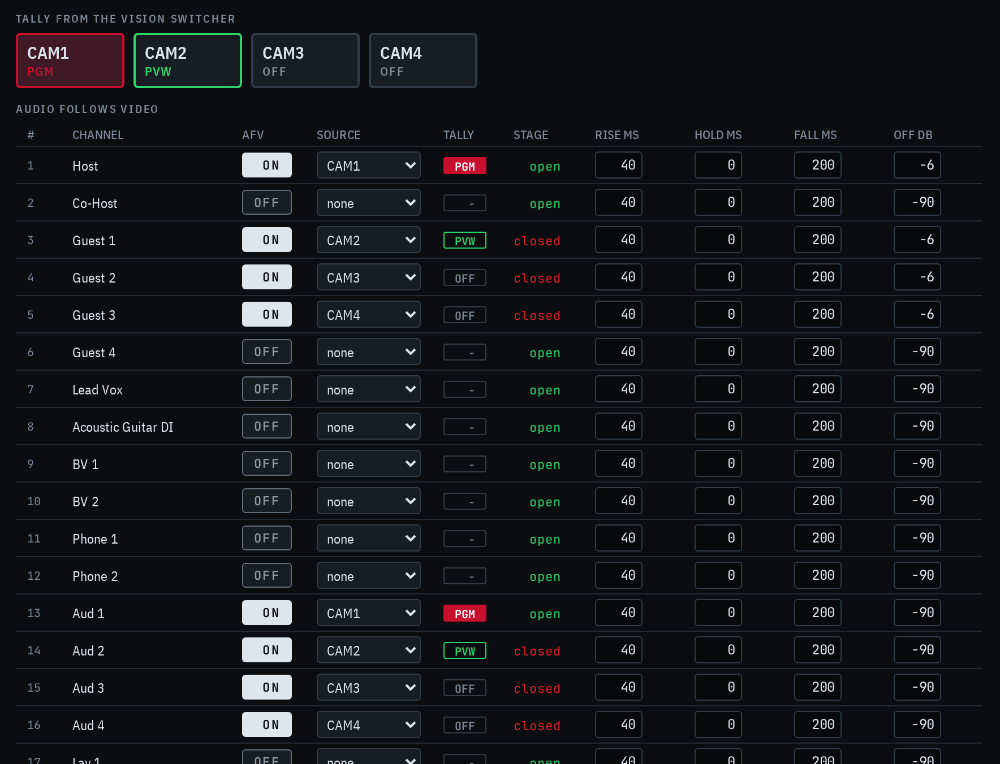
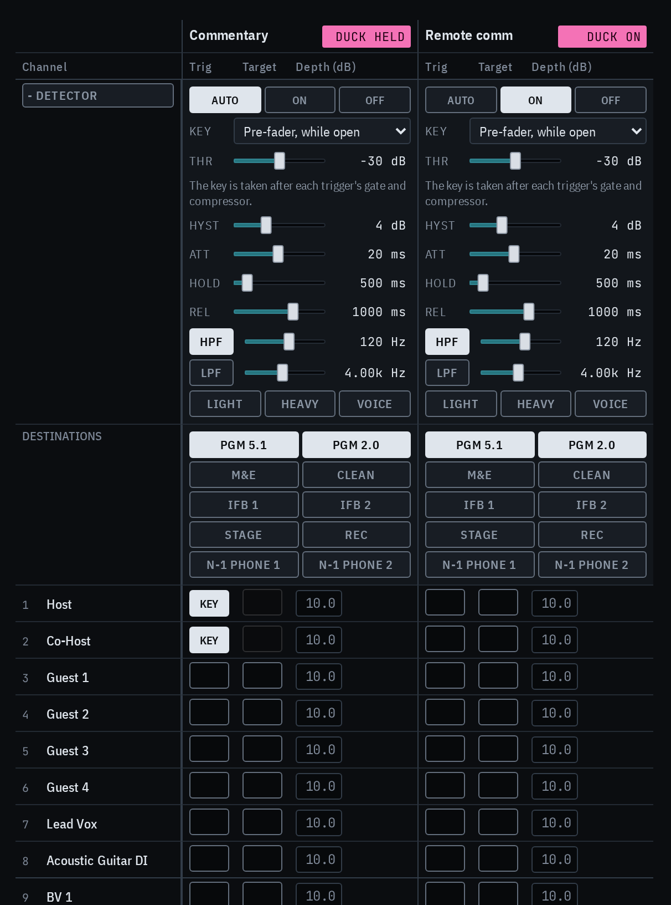
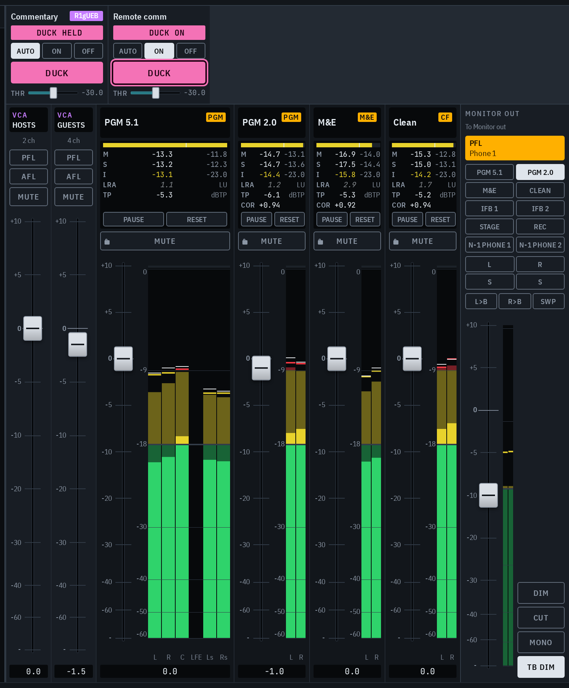
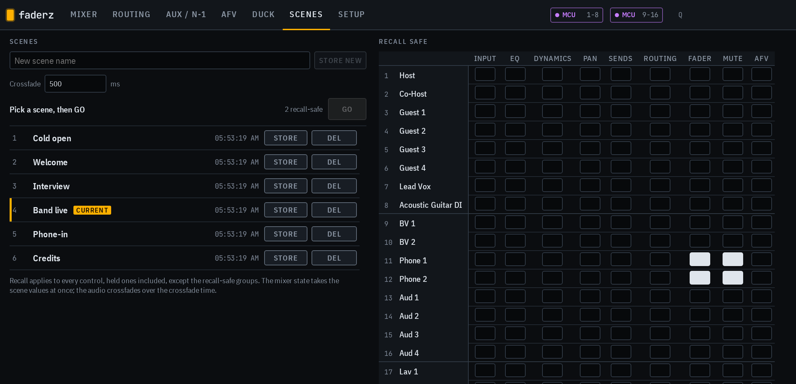
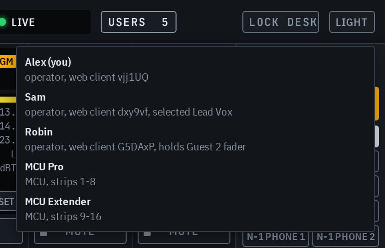
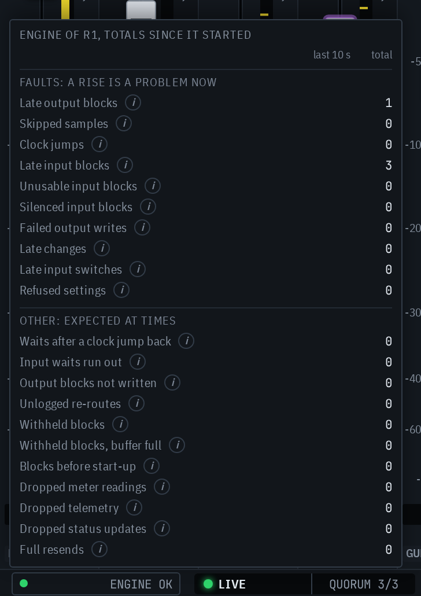
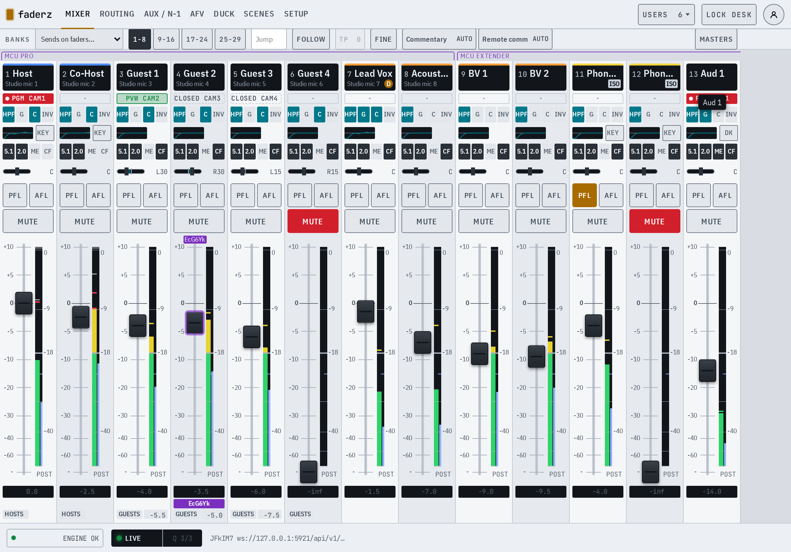

# faderz

An operated multichannel broadcast audio mixer over MXL, built on the
[samplez](https://github.com/danielclasen/samplez) engine and written in
Rust, with a web console in Svelte.

faderz reads 48 kHz audio flows from MXL domains, mixes them under a
replicated mixer state and writes every configured output to its own MXL
flow. The mixer's shape (channels, buses, auxes, mix-minus outputs, VCAs,
monitor and output flows) is fixed in one JSON configuration file; the
state is changed through a REST API and a WebSocket, which the web console
built into the binary and the control-surface bridge both speak.



## Features

- Channels of mono, stereo, 5.1 or 7.1 layout, each with an A/B input
  select, trim and leg trim, polarity, high-pass filter, four-band EQ,
  gate and compressor before or after the EQ, pan, a scribble-strip
  colour, PFL and AFL, a meter tap and a direct out
- Programme, M&E and clean-feed buses with routing per channel, auxes
  with pre or post sends, mix-minus outputs that leave chosen channels
  out of a bus, and VCAs with offsets and mutes
- A monitor section with source select, level, dim, cut, mono, Lo/Ro or
  L/R fold-down and per-speaker mutes and solos
- Peak, true-peak and loudness metering (momentary, short-term,
  integrated, LRA) against an EBU R 128, ATSC A/85 or custom target,
  streamed as binary meter frames
- Scenes with recall-safe parameter groups per element
- Audio follows video: tally from a vision switcher over REST
  (`/api/v1/afv/tally`) opens a channel or lowers it to its off level
- Several operators at once: every control a session touches is held by
  that session until it lets go, others see who holds it and can ask for
  it, and the USERS panel lists who is connected and what they hold and
  have selected
- Auth modes `none`, `token`, `proxy` (behind an authenticating proxy) and
  `oidc` (OpenID Connect sign-in in faderz itself), with operator and
  viewer roles
- A replicated state: one replica on a data directory, or a set of an odd
  number of voters with a WebSocket standby on another replica and
  failover between them
- Hardware control surfaces through `faderz-bridge` (Mackie Control over
  USB-MIDI or RTP-MIDI)
- NMOS: each channel's input an IS-04 receiver and each output a sender,
  connected over MXL through IS-05 per AMWA BCP-007-03
- `/healthz`, `/readyz` and Prometheus `/metrics`; a container image and
  a release binary

The engine applies the channel strip (trim, leg trim, polarity,
high-pass, EQ, gate, compressor), faders, mutes, VCA offsets and mutes,
AFV open and closed with the off level, mono pan and the fold-down of
wider channels, bus routing, sends, the bus, aux and mix-minus faders and
mutes, bus and aux polarity, mix-minus exclusions, the monitor's
source, channel and VCA PFL and AFL listening (PFL over AFL; PFL
centred before the pan, AFL at the pan before the AFV stage), fold-down,
level, dim, cut, mono and speaker mutes and solos, and duck groups. The
rest of the state is kept, shown and replicated but not applied to the
audio in this version: channel delay, front/rear pan, divergence and LFE
send, the stereo image setting of a channel and of the monitor, the monitor's talkback dim, bus and aux
processing (EQ, dynamics, limiter, delay), the line-up tone, mix-minus
talkback interrupts, the AFV rise, hold and fall times, and the scene
crossfade time.

## The console

The web console has seven views: MIXER, ROUTING, AUX / N-1, AFV, DUCK,
SCENES and SETUP. It runs in a desktop browser, on a tablet and on a phone, in a
dark or a light theme. `web/README.md` documents it in detail: its
connection handling, sign-in, keyboard control and tests.

Selecting a strip opens its processing panel: input colour, trim,
polarity, high-pass, delay, meter and direct-out taps, pan, the EQ with
its curve, gate and compressor.



Auxes and mix-minus outputs have their own masters with loudness meters,
a talkback source per mix-minus, the send matrix and the mix-minus
exclusions.



The AFV view shows the tally the vision switcher reports and which
channels follow which camera.



Duck groups lower ambience and music under commentary. The DUCK view
sets up each group's triggers, targets with their depth, destinations
and detector; a tile per group in the masters latches, holds, bypasses
and sets the threshold on air.

Each group is a samplez duck detector keyed by its trigger channels
after their strips, at the gain its key tap gives: 1 pre-fader, 1 or 0
pre-fader while open (fader open, not muted, no VCA mute), the fader,
mute and VCA gain post-fader. It lowers each target channel by its depth
in the outputs and engine meters of the group's destinations, and in
the monitor while the monitor's source is one of them; overlapping
groups lower a channel by the deepest. A shape with duck groups gives
the engine every column of a bus, aux, mix-minus or monitor output as a
`duckColumns` column. samplez counts each coefficient of such a column
six times against 150 coefficients per sample of the block, refuses a
configuration that exceeds that and names the `engine.blockSize` that
takes it. The meter frames carry each group's key level, envelope and
whether it is engaged.





Scenes are stored and recalled from the SCENES view; recall-safe groups
keep chosen parameters of a channel out of every recall. The view's note
on crossfading describes the contract's recall; the engine takes a recall
at once, without the crossfade.



Every screen is a session. The USERS panel lists the screens and
surfaces connected to the replica, with what each holds and has
selected. The ENGINE lamp in the status bar opens the engine's counters
of the replica serving the screen and shows WARN while one of them has
grown in the last 10 s.





Below 1400 px of width the strips take the full width and the MASTERS
key shows the masters over them.



The screenshots are taken from the UI's dev mock with invented show data
(`web/tests/screenshots/`). The mock's meters carry a correlation value
(COR), which the engine does not measure: against faderz it reads
`--.--`.

## Quick start

This builds the image from this repository and starts it with a small
shape and no `mxl` section: the state, the API and the console are
served, no engine runs and nothing is mixed. Releases publish the same
image as `ghcr.io/danielclasen/faderz:<version>`. The configuration and
the data directory go to a directory of their own, outside the build
context.

```sh
docker build -t faderz:local .
cd "$(mktemp -d)"
mkdir -p data
cat > config.json <<'JSON'
{
  "listeners": {
    "api": { "bind": "0.0.0.0", "port": 8080 },
    "ops": { "bind": "0.0.0.0", "port": 9090 }
  },
  "replica": { "name": "studio" },
  "shape": {
    "sampleRate": 48000,
    "frameRate": { "numerator": 25, "denominator": 1 },
    "channels": [
      { "id": "host", "name": "Host", "width": 1, "layout": "mono", "altInput": false },
      { "id": "guest", "name": "Guest", "width": 1, "layout": "mono", "altInput": false },
      { "id": "band", "name": "Band", "width": 2, "layout": "stereo", "altInput": false }
    ],
    "buses": [{ "id": "pgm", "name": "PGM", "kind": "program", "width": 2, "layout": "stereo" }],
    "auxes": [{ "id": "ifb", "name": "IFB", "width": 1, "layout": "mono" }],
    "mixMinus": [],
    "vcas": [{ "id": "talent", "name": "TALENT" }],
    "monitorOutputs": [{ "id": "mon", "name": "Monitor", "width": 2, "layout": "stereo" }],
    "outputs": [{ "id": "out-pgm", "name": "PGM out", "source": "pgm", "width": 2, "layout": "stereo" }]
  }
}
JSON
docker run --rm --name faderz --user "$(id -u):$(id -g)" --read-only --tmpfs /tmp \
  -v "$PWD/config.json:/etc/faderz/config.json:ro" -v "$PWD/data:/var/lib/faderz" \
  -p 127.0.0.1:8080:8080 -p 127.0.0.1:9090:9090 \
  faderz:local
```

Open <http://127.0.0.1:8080/>, or in another shell:

```sh
curl -s http://127.0.0.1:8080/api/v1/state
curl -s http://127.0.0.1:9090/metrics
```

The state is kept in `data/` and survives a restart. Without an `mxl`
section `/healthz` and `/readyz` answer 503 (see [Health](#health)).
With `auth.mode` `none` the API answers only requests whose `Host` is
`localhost`, `127.0.0.1` or listed in `api.allowedHosts`, and takes
WebSocket upgrades only from the origins `http://localhost:<api port>`
and `http://127.0.0.1:<api port>` or those in `api.allowedOrigins`, so
the host port above is the container's.

### With audio

The `mxl` section names the libmxl domains and the flow each channel
reads and each output writes; every channel and every output needs one.
An MXL domain is a directory on tmpfs shared with the processes that
write and read its flows; here `/dev/shm/mxl/studio`, writable by the
image's user, uid 65532.

```json
"mxl": {
  "domains": [{ "name": "studio", "path": "/mxl/studio" }],
  "inputs": {
    "host": { "flow": "00000000-0000-4000-8000-000000000001" },
    "guest": { "flow": "00000000-0000-4000-8000-000000000002" },
    "band": { "flow": "00000000-0000-4000-8000-000000000003" }
  },
  "outputs": {
    "out-pgm": { "flow": "00000000-0000-4000-8000-000000000010" }
  }
}
```

```sh
docker run --rm --name faderz --read-only --tmpfs /tmp \
  --cap-drop ALL --cap-add SYS_NICE --cap-add IPC_LOCK \
  -v /dev/shm/mxl/studio:/mxl/studio \
  -v "$PWD/config.json:/etc/faderz/config.json:ro" -v faderz-data:/var/lib/faderz \
  -p 127.0.0.1:8080:8080 -p 127.0.0.1:9090:9090 \
  faderz:local
```

The image runs as uid 65532. `SYS_NICE` and `IPC_LOCK` give the engine's
real-time thread `SCHED_FIFO` and locked memory; without them it starts
degraded and logs so (`faderz: rt ...`).

## Configuration

One JSON file, `faderz --config <file>`. Unknown keys are refused,
except under `engine` and `rt`, which are checked only when an `mxl`
section is present. `faderz --help` lists the flags. Each `auth` setting
below with a flag can also be given as that flag or as its environment
variable; the flag wins over the variable, the variable over the file.

| Key | Default | |
|---|---|---|
| `listeners.api` | `127.0.0.1:8080` | `{bind, port, tls}`: `/api/v1`, `/api/v1/ws` and the console |
| `listeners.ops` | `0.0.0.0:9090` | `{bind, port, tls}`: `/healthz`, `/readyz`, `/metrics` |
| `listeners.machine` | none | `{bind, port, tls}`: a bearer-only listener for machine clients; `proxy` mode only |
| `listeners.nmos` | `127.0.0.1:8081` | `{bind, port, tls}`: the NMOS Node and Connection APIs with `nmos.enabled`, unauthenticated; bound at start, serving nothing without; `tls.mode` `none` only |
| `listeners.*.tls` | `{"mode": "none"}` | `none`; `files` with `certFile`, `keyFile` and optional `clientCaFile`, re-read when they change; `selfSigned` with `sans`, generated at start |
| `auth.mode` | `none` | `none`, `token`, `proxy` or `oidc`; `--auth-mode`, `FADERZ_AUTH_MODE` |
| `auth.token.file` | | the API bearer token's file; required in `token` mode, optional in `oidc` mode |
| `auth.machineToken.file` | | the machine listener's bearer token; `proxy` mode |
| `auth.proxy.userHeader` | `X-Forwarded-User` | `proxy` mode: the header naming the user |
| `auth.proxy.groupsHeader` | `X-Forwarded-Groups` | `proxy` mode: comma-separated groups |
| `auth.proxy.groupRoles` | `{}` | `proxy` mode: group name to `operator` or `viewer` |
| `auth.oidc.*` | | `oidc` mode; the keys, flags and variables are in `web/README.md` |
| `api.allowedHosts` | `[]` | `Host` names accepted on requests without a bearer token, besides `localhost` and `127.0.0.1` |
| `api.allowedOrigins` | `[]` | `Origin` values accepted on WebSocket upgrades, besides `localhost` and `127.0.0.1` on the API port |
| `replica.name` | the host name | the replica's id towards clients |
| `replica.dataDir` | `/var/lib/faderz` | the replicated log and snapshots |
| `replica.replicas` | `1` | the voters of the replica set, an odd count |
| `replica.ordinal` | from the name | this replica's ordinal in a set |
| `replica.peers` | | every replica's peer address, `host:port`, by ordinal |
| `replica.peer` | | `{bind, port, tls}`: the peer listener of a set |
| `replica.marker` | | the ConfigMap a set starts from; `FADERZ_REPLICA_MARKER` when the file sets none |
| `replica.maxApplyLeadMs` | `50` | 30 to 120: the most a set's apply lead may grow to; see [Lateness and lead](#lateness-and-lead) |
| `shape` | required | the mixer's shape, model `Shape` in `api/ws/model.schema.json` |
| `consoles` | `[]` | consoles known before any registers: `id`, `name`, `protocol` (`mcu`), `transport` (`bridge`), `strips` (8) |
| `mxl.libraryPath` | `/opt/mxl/lib/libmxl.so` | libmxl, loaded at start |
| `mxl.domains` | | `[{name, path, id}]`: the mounted MXL domains; `id`, the domain's MXL id, for NMOS when the domain has no `domain_def.json` |
| `mxl.inputs.<channel>` | | `flow`; `altFlow` for a channel with `altInput`; `domain` with more than one domain; `channels`, the 1-based flow channel each leg reads |
| `mxl.outputs.<output>` | | `flow` in a set of one; `flows`, one member flow per replica by ordinal, in a set of more; `domain` with more than one domain; `mergedFlow`, the flow merging the member flows, which the NMOS sender names, in a set of more with `nmos.enabled` |
| `engine.sampleRate` | `48000` | |
| `engine.blockSize` | `48` | samples per block |
| `engine.readerMarginSamples` | `1536` | read delay behind libmxl's clock; delays every output by as much |
| `engine.maxCatchupBlocks` | `2` | overdue blocks processed in order after a late wake |
| `engine.pruneAfterBlocks` | `50` | blocks of a frozen producer head before an input is pruned |
| `engine.rampSamples` | `480` | the length of every gain ramp |
| `engine.delayBudgetSamples` | `4194304` | the most delay-line history the inputs may hold together, in samples; also what a replica of a set reads from another when it resyncs |
| `rt.enabled` | `true` | `false` skips capabilities, memory locking and `SCHED_FIFO` |
| `rt.priority` | `70` | `SCHED_FIFO` priority |
| `rt.rtCpu` | `auto` | `auto`, `none`, `first`, `last` or an index into the allowed CPUs |
| `nmos.enabled` | `false` | register with an NMOS registry and take IS-05 connections; needs the `mxl` section |
| `nmos.seed` | replica name | what every NMOS id derives from; the StatefulSet's name in a set of more |
| `nmos.advertiseHost` | | host controllers reach `listeners.nmos` at; required with `nmos.enabled` |
| `nmos.advertisePort` | `0` | port controllers reach it at; 0 is `listeners.nmos.port` |
| `nmos.registry.url` | | Registration API, `http://host:port`; absent, DNS-SD finds one |
| `nmos.registry.dnsSdDomain` | | unicast DNS-SD domain; absent, the resolver's search domains, then mDNS |
| `nmos.heartbeatS` | `5` | 1 to 10: seconds between heartbeats |
| `nmos.asset.manufacturer` | `danielclasen` | BCP-002-02 manufacturer tag |
| `nmos.peers` | `replica.peers` hosts on `listeners.nmos.port` | `host:port` of each replica's NMOS listener by ordinal, which staging is forwarded to; in a set of more |

Without an `mxl` section faderz runs no engine: the state is served,
nothing is mixed and `/readyz` fails. In `proxy` mode faderz takes the
user the identity headers name, so it refuses to start unless
`listeners.api.bind` is a loopback address, where only the proxy beside
it reaches it.

### A replica set

With `replica.replicas` above 1, faderz runs as one pod of a
StatefulSet per voter, the pods reaching each other on the peer
listener:

- Leave `replica.name` and `replica.ordinal` out: each pod takes its pod
  name and the ordinal that name ends in. A `name` given in a set needs
  an `ordinal`.
- `replica.peers` names every pod's peer address by ordinal, as many as
  `replicas`, each once: `<pod>.<headless service>:<port>`.
- `replica.peer` needs `tls.mode` `files` with a `clientCaFile` that has
  issued every replica's certificate; each certificate names the host of
  its `peers` address, which the others check. Port 0 is refused.
- `replica.marker` (or `FADERZ_REPLICA_MARKER`) names a ConfigMap in the
  pod's namespace: ordinal 0 creates it, the others read it to join, so
  the pods' service account needs to get and create ConfigMaps there.
- Ordinal 0 starts a set only while a majority of the voters answer, so
  the StatefulSet starts its pods in parallel
  (`podManagementPolicy: Parallel`).
- A set starts on empty volumes. The data directory of a set of one
  cannot join a set, nor that of a set run alone, so changing between
  the two needs new volumes and leaves the state behind.
- In `oidc` mode the replicas behind one host name share
  `auth.oidc.sessionKey`.
- The configuration that changes how a command applies, the shape, the
  declared consoles, each channel's input flows and domain, and the
  version of how the release derives engine targets from the state, is
  equal on every replica: the leader orders no command while a replica
  reports another, and a replica of another one exits rather than
  install the set's snapshot. Changing it needs every replica stopped.
- A snapshot carries its format, 3, which faderz 0.2.0 and earlier
  cannot read. Rolling a set back to such an image needs the volumes
  that image wrote, or empty volumes and a new set.
- With an `mxl` section every replica runs an engine of its own
  (below); without one the set serves the state and mixes nothing.
- Each replica lists every replica of the set in `GET /api/v1/replicas`
  and the WebSocket's `replicas` message, named as the pods are,
  `<StatefulSet>-<ordinal>` (with a `name` that ends in no ordinal, the
  replica's `peers` address, `host:port`), with the leader raft
  follows. Another replica is healthy while this one is in contact with
  a majority and has had a report from it within the contact window.
  Every entry, this replica's own included, is commitable while it is
  healthy and a majority of the voters is. Without an engine there is
  no contact and only raft's view: a follower vouches for the leader
  alone, for as long as raft names one (it drops the name when no
  heartbeat arrives within the election timeout), and the leader for a
  follower whose matched log is within 16 entries of its own and that
  has matched all of it within the last 3 s.

### Engines in a set

Every replica reads the same input flows and writes its own member flow
of each output: `mxl.outputs.<output>.flows` lists one flow per replica,
by ordinal, and replica n writes the n-th. No two outputs or replicas
name the same flow, and none names an input's. faderz writes no flow
that merges the members; whatever merges them lists the member flows,
so a change of `flows` changes that list in the same change.

The engine follows the replicated log (samplez's replicated mode). Each
log entry's engine entries are derived from the mixer state as the entry
applies: the difference between the gains, strip parameters, duck group
settings and masks and input flows the state sets before and after it. So every replica hands its
engine the same entries at the same sample index. The engines hash the
pages they compute and the set compares them; a replica whose pages
differ is withdrawn and resynced from another replica's engine core.

- A replica starts contact with the set, and its engine with it, as it
  starts: joining, a learner or catching up. samplez promotes a learner
  on the reports contact sends, and rebuilds the engine of a replica
  that took entries past their deadlines from the state it applied.
  Contact or the rollout failing to start exits faderz non-zero.
- A replica starts with its engine idle and builds the engine's core
  from the state it applied once its clock is verified; it commits its
  outputs once its pages match the others'. A replica restarted on its
  volume catches up the same way.
- An input the engine prunes is written to the log as down, and one
  readable again as up, so every replica silences and raises it at the
  same index. Only the leader orders these entries: a report made
  while following, or lost to an election, is appended again once the
  replica leads while the log does not hold it, after the write timeout
  and then at doubling intervals up to four times it; a later report on
  the same input replaces it.
- A command that switches an input is ordered alone and stamped later
  by the longest time a replica reports for building an input
  generation; the commands ordered after it take effect no earlier. One
  that would switch inputs of more than one MXL domain is refused.
- The compatibility key a rollout hands the set over by hashes the
  samplez engine version, the mixer configuration, the `engine` settings
  and each channel's flow channel selection; the member flows are left
  out. Each replica reads its StatefulSet's target revision every 5 s,
  which needs `get` on `statefulsets`, and its own revision from
  `FADERZ_POD_REVISION`, the pod's `controller-revision-hash` label
  through the downward API. The StatefulSet is the pod name without its
  `-<ordinal>`; the marker ConfigMap is owned by it, so it is deleted
  after the StatefulSet.

### Lateness and lead

The leader stamps every entry with a sample index a lead ahead of the
set's processed index. Each replica has to apply the entry before that
index, less a guard of 20 ms at the default timing; an entry a replica
applies later is unresolved there, its record never reaches that
replica's engine, and the log decides it: it is applied again at a
later index, or the replica is resynced. The leader raises the lead on
the slack every replica reports when it hands an entry to its engine,
up to `replica.maxApplyLeadMs`.

A larger cap keeps a set whose slowest follower applies late, such as
one whose volume syncs slowly, free of unresolved entries; it is also
the longest a control change can take from the write to the audio. In
samplez's tests a follower with a 20 ms fsync settles the lead near
76 ms, above the default of 50.

## API

The contract is in `api/`: `openapi.yaml` for REST under `/api/v1` and
`ws/*.schema.json` for the WebSocket at `/api/v1/ws`. Writes carry a
client-generated command id that is applied at most once across all
replicas; a write is answered once the log entry carrying it has
committed.

| Method and path | |
|---|---|
| `GET /api/v1/state` | shape, live state, owners and the revision |
| `PATCH /api/v1/state` | write one or more controls atomically |
| `GET /api/v1/replicas` | the replica set as the serving replica sees it |
| `GET /api/v1/status` | the serving replica's role, readiness and contact state, and its engine's inputs (state, flow, blocks copied, late and too late) and outputs |
| `POST /api/v1/scenes`, `PUT` and `DELETE /api/v1/scenes/{id}` | store, overwrite or rename, and delete scenes |
| `POST /api/v1/scenes/{id}/recall` | recall a scene |
| `POST /api/v1/afv/tally`, `PUT /api/v1/afv/tally` | one source's tally change, or the full tally state |
| `POST /api/v1/loudness/reset` | restart the loudness measurement of outputs |
| `GET /api/v1/consoles`, `PUT` and `DELETE /api/v1/consoles/{id}` | the control surfaces |
| `GET /api/v1/ws` | the WebSocket: commands, deltas, meters, counters and presence |
| `GET /api/v1/session`, `POST /api/v1/login`, `GET /api/v1/login`, `POST /api/v1/logout` | sign-in |

State-changing requests without a bearer token need the header
`X-Samplez-Request: 1` and `Content-Type: application/json`:

```sh
curl -s -X PATCH http://127.0.0.1:8080/api/v1/state \
  -H 'X-Samplez-Request: 1' -H 'Content-Type: application/json' \
  -d "{\"commandId\":\"$(cat /proc/sys/kernel/random/uuid)\",\"changes\":[{\"path\":\"/channels/host/fader\",\"value\":-6}]}"
```

### Health

The ops listener serves `/healthz`, `/readyz` and `/metrics`. `/healthz`
passes while the engine's real-time thread advances its heartbeat, so it
answers 503 whenever no engine runs. `/readyz` passes once the replica is
ready and, in a set of one, the engine plays the state.

- A set of one with an `mxl` section: both pass once the engine runs.
- A set of one without an `mxl` section: both answer 503.
- A set of more than one replica with an `mxl` section: `/healthz` passes
  while the engine runs, with or without a core. `/readyz` passes once
  the replica has joined and caught up and commits its outputs, or while
  no other replica in contact with it commits. A replica with outputs
  fails it while diverged, resyncing or of another compatibility key
  than the set's baseline, and while withdrawn once the set applied its
  first baseline: such a replica writes none of what it computes.
  Before that first baseline a withdrawn replica passes, so the first
  replicas of a new set turn ready. A learner is never ready. The set's
  only voter is ready once it has joined and caught up, whatever its
  state.
- A set of more than one replica without an `mxl` section: `/readyz`
  follows the replica alone and passes once it has joined and caught up,
  while `/healthz` answers 503. A liveness probe on `/healthz` restarts
  such a pod over and over, so such a set takes none on `/healthz`.

Besides samplez's metrics, faderz exports
`faderz_engine_resends_total`, `faderz_engine_resend_pending` and, per
channel input, `faderz_input_attached`,
`faderz_input_margin_needed_samples`, `faderz_input_copied_blocks_total`,
`faderz_input_late_blocks_total` and `faderz_input_too_late_blocks_total`.

## NMOS

With `nmos.enabled` faderz is one NMOS Node (IS-04 v1.3, IS-05 v1.2,
AMWA BCP-007-03 for MXL): a Receiver per channel, which is the channel's
input reader, and a Source, Flow and Sender per output, all with
transport `urn:x-nmos:transport:mxl` and 32-bit float audio at 48 kHz.
The ids derive from `nmos.seed`, so a restart keeps them. Each domain's
MXL id comes from its `domain_def.json`, else from `mxl.domains[].id`;
neither, or two that differ, stops faderz at start.

- A receiver's `/active` flow is the flow of the channel's selected
  input: an activation sets the flow of input a or b, whichever the
  channel selects, and switching between them in the console changes
  `/active`. `master_enable` false detaches the channel; it reads
  nothing and is silent until activated again. A flow any output of
  the set writes or merges into is refused with 400.
- A sender's flow is the output's (`mergedFlow` in a set of more), and
  `master_enable` false stops the output and removes its flow on every
  replica; `true` writes it again.
- Activations go through the replicated log like any command, so every
  replica of a set routes alike and a restart keeps them. An
  activation takes effect once it is ordered and applied, no earlier
  than its activation time and later by at least one commit and the
  engine's lead; faderz cannot place it on a given sample. One that is
  not applied shows the state's connection again in `/active`.
- A scheduled activation is taken into the replicated state when it is
  staged, and the replica leading at its time orders it, so it fires
  after a leader change too; a cancel removes it from the state.
- Every replica serves the Node and Connection APIs under the same ids,
  and each shows in `/active` what is in the state, the `activation`
  included. The other replicas forward `/staged` and `/bulk` to the
  leader, at `nmos.peers` by ordinal (a set refuses a loopback NMOS
  listener without them), so staging on one replica and activating on
  another work together; while the set elects a leader they answer
  503, and 502 or 504 when the leader cannot be reached or does not
  answer.
- A scheduled activation taken by an earlier leader, or before a
  restart, shows in the leader's `/staged` as an absolute one at its
  time and locks it (423) until it fires or a cancel, through any
  replica, removes it; `/bulk` does not lock it. A scheduled activation
  of the connection the port already has is not taken.
- Staged parameters not yet activated are lost when the leader
  changes.
- Only the leader registers the Node, and only while a quorum of the
  set acknowledges it; a leader cut off from the others may still post
  for up to a second while the new one registers. A replica of a set of
  more that stops leaves the Node registered, and the next leader
  continues that registration under the same ids; a set of one deletes
  it.
- At start the engine reads and writes what the state holds: a
  detached channel opens no reader and a disabled sender's output
  creates no flow.
- The listener is unauthenticated (no IS-10), and its activations
  re-route inputs and start and stop outputs.

CI runs the AMWA nmos-testing suites IS-04-01 (unicast and multicast
DNS-SD), IS-05-01 and BCP-007-03-01 against the image
(`tests/nmos/conformance.sh`); every result is Pass but those
`tests/nmos/expected.json` lists, each with its reason from the tool's
source. Among them are two Manual tests, IS-04-01 test_22 (ids kept
across a restart) and BCP-007-03-01 test_15 (`master_enable` stops and
starts the flow), which `tests/nmos.rs` covers.

## Control surfaces

`faderz-bridge` in `bridge/` drives Mackie Control surfaces, an X-Touch
and X-Touch Extenders, over USB-MIDI or over the network by RTP-MIDI,
and connects to faderz as a console client: fader touch and moves, motors, mute, solo, select, bank
and the scribble strips. It signs in with a token or by the OAuth 2.0
device grant. Its mapping follows the MCU reference and has not been
verified on hardware. Releases publish it as a binary and as
`ghcr.io/danielclasen/faderz-bridge:<version>`; `bridge/README.md` has
its configuration.

## Building and testing

`docker build -t faderz:local .` builds the console, the binary with the
console built into it, and the image. The Rust build needs libmxl, which
the samplez builder image carries; CI builds and tests in it:

```sh
cd web && npm ci && npm run build && cd ..
mkdir -p .cargo-registry .cargo-git
docker run --rm --user "$(id -u):$(id -g)" \
  -v "$PWD:/w" -v "$PWD/.cargo-registry:/usr/local/cargo/registry" \
  -v "$PWD/.cargo-git:/usr/local/cargo/git" -w /w \
  ghcr.io/danielclasen/samplez-builder@sha256:92ece4452be98fff177b49fb201c8c693130c08845c42725dd5b1173d4863fba \
  cargo test --locked
```

A build without `web/dist` serves a note in place of the console. The
console's checks, unit, contract and end-to-end tests, and its dev server
with a mock faderz, are described in `web/README.md`; `docker/smoke.sh
<image>` checks an image.

## Licence

Apache-2.0, see `LICENSE`.
