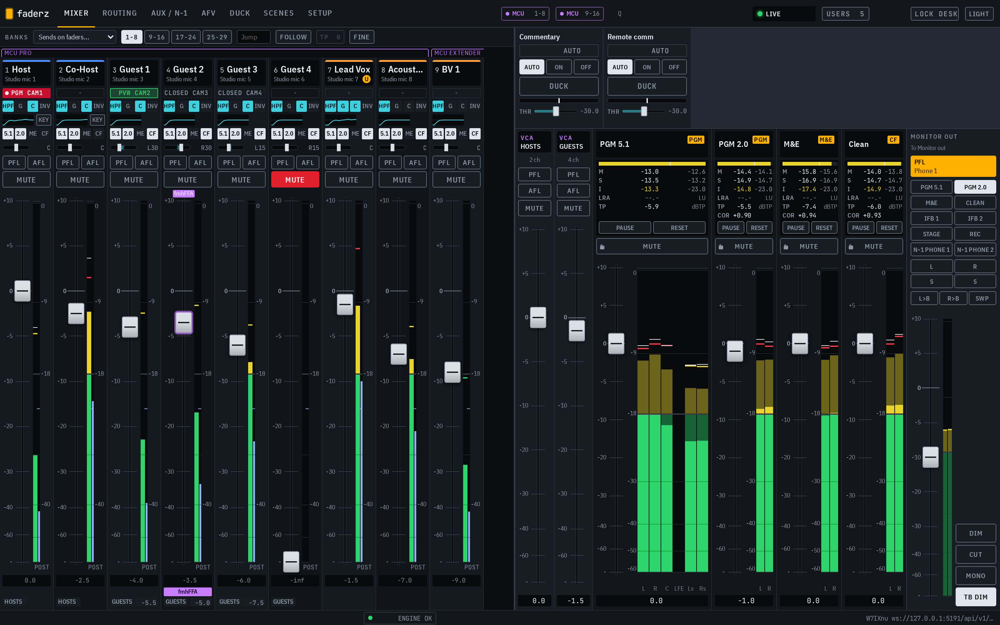
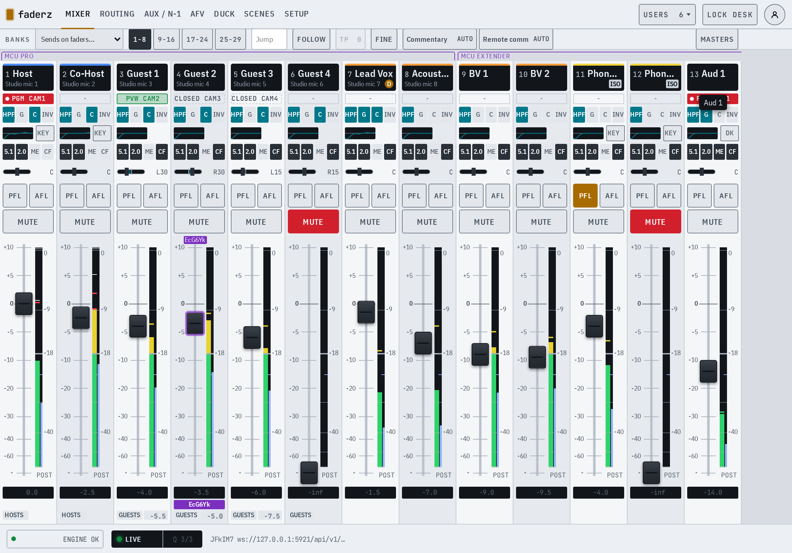
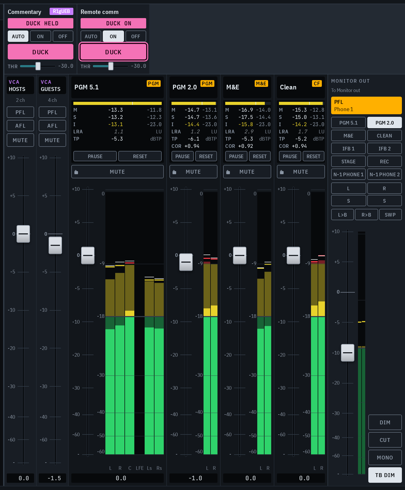

# The web console

The console is built into the faderz binary and served at `/` on the API
listener. It has seven views, MIXER, ROUTING, AUX / N-1, AFV, DUCK,
SCENES and SETUP, and runs in a desktop browser, on a tablet and on a
phone, in a dark or a light theme. What the controls do to the mix is
in [USAGE.md](USAGE.md).

Selecting a strip opens its processing panel: input colour, trim,
polarity, high-pass, delay, meter and direct-out taps, pan, the EQ with
its curve, gate and compressor, and the sends. A channel without a delay
line shows its delay greyed out, marked "No delay line". A tone
channel's head shows TONE and its frequency, with ID while its ident is
on, in place of a source, and its panel sets the frequency, the level
and IDENT in place of an input select. Below 1400 px of width
the strips take the full width and the MASTERS key shows the masters
over them.

## Status bar and connection

The status bar starts with the ENGINE lamp, then the session tag and
endpoint, then the notice line. The ENGINE lamp opens the engine
counters of the replica serving the screen, each under a name for
people with an (i) that explains it, and shows WARN while a counter
whose rise is a fault rose in the last 10 s; an input that delivers
nothing usable is named on it with the reason
([Engine counters](USAGE.md#engine-counters)).

The connection key, right of the engine lamp (in the header on a short
screen), shows the link state and the quorum: QUORUM with the number of
replicas that can commit out of the set (Q below 1200 px), amber while
that is fewer than all, and a tooltip naming the counts, the majority
needed, the leader, the replica serving this screen and any replica
down. Both open the connection details: revision, primary, standby,
meter source, quorum and leader, the faderz version and samplez release
the primary replica was built from, and each replica's role and state.

While the serving replica cannot commit, the quorum reads NO QUORUM
(NO Q) and the controls stay usable: the notice line says CHANGES NOT
COMMITTING - audio continues, with the number of writes pending, and
every key pressed meanwhile shows its state desaturated inside a dashed
edge until its write commits or expires. REST writes are answered 503
then and change nothing. A write the protocol drops raises a notice,
and its control shows the committed value again.

While the link carries no commands (connecting, offline, failing over,
ahead), every write control is disabled and the connection key shows
LOCK with the reason. A screen whose state is not in the cluster's
history, such as after the cluster was restored from a backup, applies
nothing: the link shows AHEAD, a banner names both revisions, and TAKE
CLUSTER STATE loads the cluster's state.

The LOCK DESK key in the header locks one screen against writes: a
0.5 s hold locks it, another unlocks it. A phone shows the key only
while the desk is locked.

### Connection handling

The console speaks the protocol in
[USAGE.md](USAGE.md#websocket) from a Web Worker. It also fails over
when the primary reports that it cannot commit while the standby
reports that it can, or gives no state it can apply within 3 s of a
hello, resync or promote. While neither can commit it lets the standby
go to look for a third replica that can; while no replica can commit it
stays where it is.

## Sign-in

At start the page reads `GET /api/v1/session`. In `oidc` mode a page
not signed in goes to the identity provider and back; if it went there
within the last 30 s it shows a SIGN IN link instead, so a sign-in that
does not take cannot loop. In `token` mode it asks for the API token.
When the link leaves LIVE, and every 5 s while it is down, the page
reads the session again, so an ended session brings the prompt back.

The pill at the header's right end shows the user's initials, never an
email address, and opens a menu that names the role, switches the
theme, offers Sign out in `token` and `oidc` mode, and names the faderz
version and samplez release. A viewer's write controls are locked with
the reason "signed in as a viewer".

## Other operators

When a gesture on a held control is refused, ASK in the notice sends the holder a
request, at most once per control every 3 s; the holder's screen shows
it with RELEASE. The head of a strip another screen has selected
carries that screen's initial, and its tooltip names every screen that
has it selected.

USERS counts the sessions connected to this screen's replica, the
connected control surfaces, and the sessions on other replicas that
hold a control; its panel lists each with who is signed in, the role,
the handle tag, what it holds and what it has selected. A dot on USERS
says a configured surface is disconnected. From 1301 px the header
also shows the control surfaces, each with its protocol and the strips
its bank is on.

## Meters and loudness

Each screen latches true-peak overs and holds the maximum true peak
from the meter frames it receives, so a screen opened later shows only
what it measured since. RESET restarts the loudness measurement of an
output for every client, and every screen clears that output's over and
TP maximum. PAUSE pauses an output's integration after a 0.5 s hold;
paused, the key reads PAUSED in amber and the held integrated loudness,
LRA and maxima carry a dashed amber edge on every screen; one press runs
it on. A scene recall leaves the integration paused or running, and
RESET leaves it paused. Channels latch an over only where they feed a
direct out; the TP key above the strips clears those on this screen.

Under its I and LRA a loudness readout notes the measurement's gaps and
lost slices together (`N gaps`) and, when the replica's measurement did
not start at the last reset while the state counts one, `since HH:MM`
in local time.

## Ducking

DUCK on a group's tile in the masters, or on its pill in the bank bar
between 1024 and 1399 px: a press holds the duck in at once, held longer
than 0.3 s it is momentary, and a shorter tap latches mode on, or sets
a latched group back to auto. Shift+D+n holds the n-th group while the
digit is down, in every view, and never latches. A cancelled touch, a
lost pointer, focus leaving the key, the page going hidden or leaving
the view ends a hold and changes no mode. While another session holds a
group the press holds nothing; a tap still latches. On a bypassed group
(mode OFF, hatched) a tap sends nothing, and a press holds the duck in
only once it has lasted 0.3 s. OFF takes a 0.5 s hold, AUTO and ON one
press.

The tile says what the group does: how far its deepest target is
lowered (DUCK -12.0), or DUCK HELD, DUCK ON, BYPASS or AUTO, with KEY
while the key triggers it; it sets the threshold, and its key meter
shows the key level against it. Beside the masters, with a fine pointer
and up to four groups, a summary shows per group what keys it, its key
level against its threshold, what it lowers on which outputs, and its
gain reduction. A strip in a group carries a DK chip (KEY on a
trigger), lit while a group lowers it, and opens the Duck section of
its processing panel.

The DUCK view sets up every group: mode, key tap, detector and key
filters, destinations, and per channel KEY, TARGET and the depth. The
presets LIGHT, HEAVY and VOICE write in one atomic change and take a
second press within 3 s or a 0.5 s hold. A phone shows one group at a
time.

## Talkback

TALK on a mix-minus output, by pointer, Space or Enter: held longer
than 0.3 s it talks until released; a shorter tap latches it on. A
cancelled touch, a lost pointer, focus leaving the key, leaving the
view or the page going hidden ends the talk, and a notice says why. A
press on a lit key stops the talk, whichever screen lit it. While
nothing commits, TALK starts no talk.

## Keyboard and pointer

- Faders are sliders: the arrows step 0.5 dB from -20 dB up, 1 dB down
  to -40 dB and 3 dB below (Shift 0.1 dB), Page Up/Down 5 dB, Alt+0 sets
  0 dB and Alt+End closes the fader. No single key jumps a fader, and a
  double-click does nothing to it.
- Pans step with the arrows (Shift for fine); Alt+Home and Alt+End go
  to the ends and Alt+0 centres.
- Dragging a fader with Shift or Ctrl held is fine travel; the FINE key
  in the bank bar latches fine travel for faders and pans on touch
  screens.
- The mute of an output (bus, aux, mix-minus) needs a 0.5 s hold, by
  pointer, Space or Enter; one press unmutes. Channel mutes take one
  press.
- Escape closes the channel processing panel.
- In the mixer, `[` and `]` step to the previous and next bank, the Jump
  field takes a strip number or the start of a channel name, FOLLOW
  keeps the strips on the first connected surface's bank, and a press
  on a VCA master's name shows only its members until EXIT. "Sends on
  faders" puts one aux's send levels on the channel faders until EXIT.
- A strip has five tab stops: its head (select), PFL, AFL, MUTE and the
  fader, then its VCA row while it is in a VCA. The first tab stops of
  the mixer are skip links to the masters and the monitor. Matrix grids
  move with the arrow keys.
- Typed values are written on Enter or when the field is left, and
  Escape restores the current value. They take units: `2.5k` or
  `2.5 kHz`, `-3 dB`, `40%`, `4:1`, `off`. A delay is typed in the
  selected unit (ms, frames at the shape's frame rate, or samples) or
  with a suffix, `40ms`, `2f`, `1.5s`, `1920smp`. A value outside the
  range is never clamped: the field is restored and the range shown.
- A parameter or send slider moves by the distance dragged and never
  jumps to the touch point; its arrows step a hundredth of its travel,
  Page Up and Page Down a tenth.
- A label cut off for lack of room shows its full text in a tooltip
  after a short hover, on keyboard focus and on a touch held for 0.5 s;
  Escape closes it.
