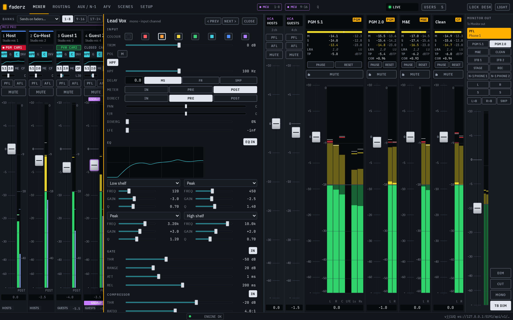
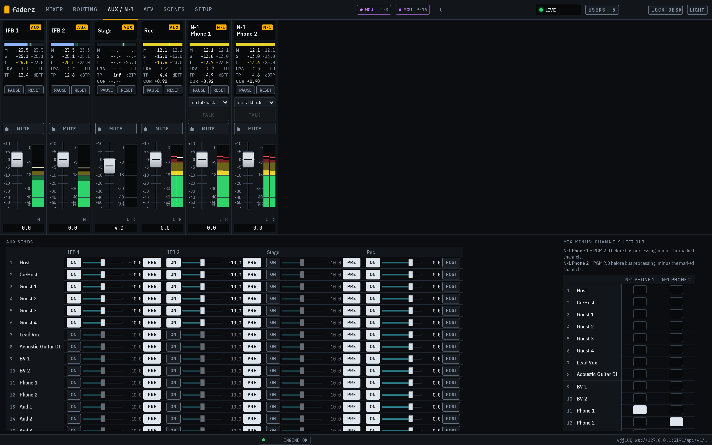
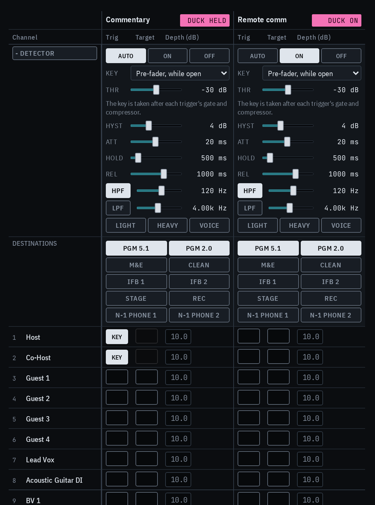
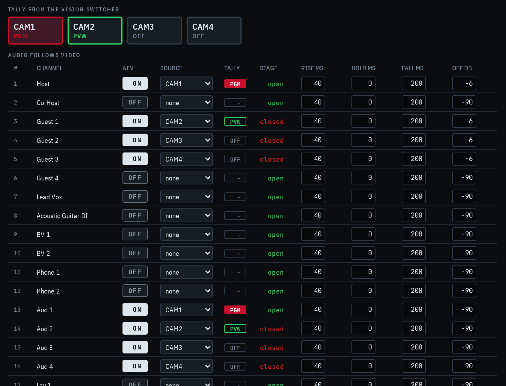
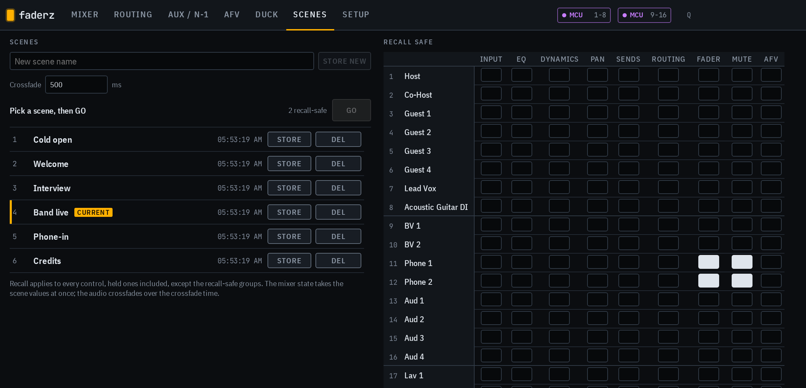
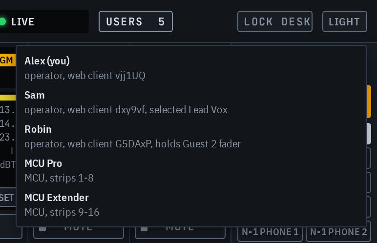
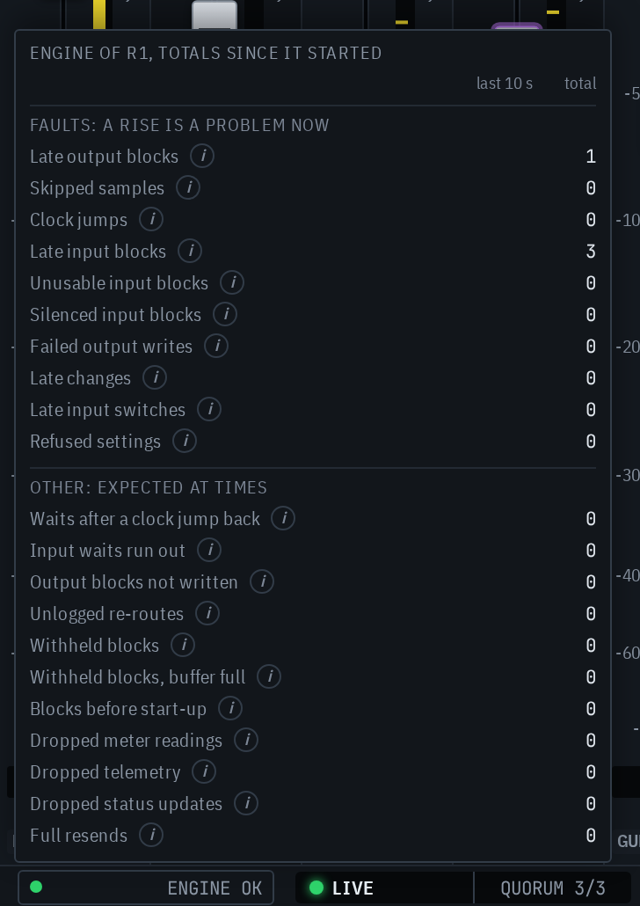

# Using faderz

How the mixer behaves, one section per feature, then its interfaces:
REST, the WebSocket, the ops endpoints and NMOS. The configuration file
is in [CONFIGURATION.md](CONFIGURATION.md), the web console in
[CONSOLE.md](CONSOLE.md) and control surfaces in
[SURFACES.md](SURFACES.md). faderz mixes on the samplez engine; how the
engine computes strips, meters, ducks and replication is in
[samplez's USAGE.md](https://github.com/danielclasen/samplez/blob/main/docs/USAGE.md).

## The shape and the state

The shape (`shape` in the configuration, model `Shape` in
`api/ws/model.schema.json`) fixes the mixer's elements: channels of
mono, stereo, 5.1 or 7.1 layout, programme, M&E and clean-feed buses,
auxes, mix-minus outputs, VCAs, monitor outputs and the outputs that
write flows. Adding or removing any of them is a configuration change
and a restart.

The live state (model `State`) is every control's value, and it changes
only through commands: a `PATCH /api/v1/state`, a WebSocket `set`, a
scene recall, a tally, an NMOS activation. Each is ordered in the
replicated log and applied on every replica, and the engine follows the
state from the log ([ARCHITECTURE.md](ARCHITECTURE.md)). A state path
names a control, as `/channels/<id>/fader` or `/buses/<id>/mute`; the
schema lists every one with its range.

## Channels

A channel has an A/B input select (`b` needs `altInput` in the shape),
trim and leg trim, polarity, a high-pass filter, a four-band EQ, a gate
and a compressor in either order (`dynamicsBeforeEq`), pan, a
scribble-strip colour, PFL and AFL, a meter tap, a direct out, a fader,
a mute and VCA membership.



### Compressor mix

`comp.mix`, 0 to 100 %, is the share of the compressed signal in the
element's output, the rest its input unchanged (parallel compression);
the makeup gain applies to the compressed share alone. The two shares
stay sample-aligned and the mix adds no latency. 100 %, the default,
is the compressor alone; a state or scene saved before the mix existed
loads as 100 %. A mix change ramps as other processing changes do.

### Channel delay

A channel delays its input by its `delay`, in samples, exactly. The
delay line is opt-in per channel through `mxl.inputs.<channel>.maxDelayMs`,
at most 5 s at 48 kHz; a channel without one takes no delay but 0, and
at 0 a channel is not late at all. The shape gives each line as
`maxDelay` in samples, and a write past it is refused. The lines are
allocated at start and together hold at most `engine.delayBudgetSamples`
samples, a line counting once per leg; a longer line is a configuration
change and a restart. A recall whose scene holds a delay past the line
sets that channel's delay to 0 and names the channel in its answer's
`delaysNotApplied`.

### Direct outs and meter taps

A direct out is an output of the shape whose `source` is a channel. At
the `input` tap it carries the channel's input after the channel delay
and before trim, filters and dynamics; at `preFader` and `postFader` it
carries the channel after them. The tap changes at run time.

A channel's meter tap (`meterTap`) is `input`, `preFader` or
`postFader`. At `input` the channel reads an engine meter of its input
after the delay and before the strip, which runs only while some
channel's tap is `input`.

### Tone channels

A channel whose input is configured `tone` in place of a `flow` plays a
line-up tone generator: a sine of whole hertz at a sample-peak level on
every leg, which the channel's strip, delay, fader and routing take as
any input's. It reads no flow, so it takes no `flow`, `altFlow`,
`domain` or `channels`, has no `altInput` and no NMOS receiver. `tone:
{}` starts it at 1 kHz and -18 dBFS; `frequency`, 20 to 20000 Hz, and
`level`, -60 to 0 dBFS, start it elsewhere. Its state is written at
`/channels/<channel>/tone/frequency`, `level` and `ident`: a level or
ident change ramps over `engine.rampSamples`, a frequency change
crossfades over as long, and a value outside its range is refused,
never clamped. With `ident` the tone stops on one leg at a time in leg
order, for 250 ms each, then sounds on every leg for 250 ms. A scene
recall leaves the tone as it is.

## Panning

A mono channel on a stereo bus pans by `pan.lr`; a stereo channel is
balanced by `pan.lr` and set by its image. A wider channel is folded
onto a narrower bus.

A mono channel on a 5.1 or 7.1 bus is panned in the field of the ITU-R
BS.775 layout (L -30, C 0, R +30, Ls -110, Rs +110 degrees; 7.1 takes
its sides at +-90 and its rear surrounds at +-135), every law at
constant power:

- `pan.lr` pans pairwise between adjacent speakers at the front (the
  centre of the field is the C leg alone) and between the surrounds at
  the rear;
- `pan.spread` blends that with a plain pan between L and R, none of it
  at 0 and all of it at 1;
- `pan.frontRear` crossfades front and rear, -1 the front alone and 1
  the rear alone;
- `pan.lfeSend` is a send onto the LFE leg, silent at -90 dB.

A new channel is at the front (`frontRear` -1) with full spread and no
LFE send; lower `spread` to use the C leg. A send, a direct out and a
PFL listen put a mono channel there too, as the L/R pair. The older
`pan.fr`, `pan.divergence` and `pan.lfe` are stored and never read. A
stereo channel on a surround bus is balanced by `pan.lr` onto its L and
R legs alone.

## Buses, auxes and mix-minus outputs

Each channel routes to the programme, M&E and clean-feed buses; auxes
take pre- or post-fader sends; a mix-minus output is a bus less the
channels it excludes, with a talkback source that interrupts it. Each
element has a fader, a mute and polarity, and VCAs apply offsets and
mutes to their member channels.



### Output processing

A bus's, aux's or mix-minus output's EQ, gate and compressor, in its
`dynamicsBeforeEq` order, run on each output carrying it, after the
element's fader and mute and before the output's limiter: on the mix,
on the line-up tone while it replaces the mix, and on a mix-minus
output's talkback while it interrupts. A bus's polarity stays in the
mix, per leg. An output narrower than its element processes the
fold-down, so a stereo and a mono output of one bus each compress on
their own signal. The monitor, AFL and the mix-minus outputs of a bus
sum the element's channels and hear neither its processing nor its
limiter. A mix-minus output's EQ and dynamics are set through the API
at `/mixMinus/<id>/eq/...`, `gate/...`, `comp/...` and
`dynamicsBeforeEq`; the console has no control for them.

A bus and an aux each have a true-peak limiter on every output carrying
them. Such an output is late by the limiter's look-ahead whether the
limiter is on or off, so turning it on needs no restart; an output
carrying a mix-minus, a direct out or the monitor is not. The limiter
is samplez's output limiter.

### Bus and aux delay

A bus or aux delays every output carrying it by its `delay`, in samples,
exactly, after its EQ and dynamics and before the output's limiter. A
mix-minus output of the bus, the monitor and AFL are not delayed. The
line is opt-in per output through `mxl.outputs.<output>.maxDelayMs`,
which is the same on every output carrying one bus or aux and refused
on an output carrying anything else. The shape gives the element's line
as its `maxDelay`; without one it takes no delay but 0, and a write past
it is refused. Each output's line counts once per leg in
`engine.delayBudgetSamples`, beside the channels'. A recall sets a
delay past its line to 0 and names it in `delaysNotApplied`.

### Fold-down

An output may be narrower than the element it names as its `source`:
it then writes the source folded down, 5.1 and 7.1 onto stereo by the
ITU-R BS.775 Lo/Ro equations (centre and surrounds at -3 dB, LFE
dropped), 7.1 onto 5.1 (L, R, C and LFE passed, Ls and Rs each the sum
of the side and rear surround of their side at -3 dB), and stereo or
wider onto mono.

An element's meter reads the level after its processing, delay and
limiter on the first output in `outputs` that carries it at full width.
An element carried only by narrower outputs gets an engine meter of its
own on its matrix columns, before any processing, counted against the
meters the engine allows. A narrower output has no meter of its own.

## Monitor

The monitor section selects a source (a bus, aux or mix-minus), with
level, dim, talkback dim, cut, mono, Lo/Ro or L/R fold-down and
per-speaker mutes and solos. Channel and VCA PFL and AFL replace the
source while any is on, PFL over AFL: PFL is taken centred before the
pan, AFL at the pan before the AFV stage. Every monitor output gets an
engine meter of its own, which reads what the monitor plays before its
level, dim, cut, mono and speaker mutes and solos.

## Line-up tone

The line-up tone (`/tone`) is a 1 kHz sine at `level`, -30 to 0 dBFS
sample peak, on every leg. While `on`, each output whose bus, aux or
mix-minus is in `targets` carries the tone in place of its mix, after
the element's fader and before the output's strip and limiter, so the
fader does not scale it and the element's EQ, dynamics and limiter
still apply. An output narrower than its element carries the tone's
first legs. The element's meters show the tone, and a monitor playing
the element plays it through its own controls; while a channel or VCA
solos, the monitor plays the listen sum. Turning it on or off, a target
and a level change ramp over `engine.rampSamples`. With `ident` the
tone stops on one of the target's legs at a time in layout order, for
250 ms each, then sounds on every leg for 250 ms.

## Duck groups

A duck group lowers target channels, such as ambience and music, while
its trigger channels, such as commentary, speak. Each group is a samplez
duck detector keyed by its triggers after their strips, at the gain its
key tap gives: 1 pre-fader; 1 or 0 pre-fader while open (fader open, not
muted, no VCA mute); the fader, mute and VCA gain post-fader. It lowers
each target by its depth in the outputs and engine meters of the
group's destinations, and in the monitor while the monitor's source is
one of them; overlapping groups lower a channel by the deepest. Each
group has a mode (`auto`, `on`, `off` for bypassed) and a momentary
`hold`. A mix-minus carrying its talkback is never ducked.

A shape with duck groups gives the engine every column of a bus, aux,
mix-minus or monitor output as a `duckColumns` column; what such a
column costs, and the configuration samplez refuses for it, is in
[samplez's USAGE.md](https://github.com/danielclasen/samplez/blob/main/docs/USAGE.md). The meter frames carry each group's
key level, envelope and whether it is engaged.

A group in the shape's `ducks` may seed its initial state, so a fresh
start ducks with no operator step: `triggers` and `targets` (channel
ids), the `depth` every channel of the group starts at (dB, 10 if
absent), and the `threshold`, `attackMs` and `releaseMs` of its
detector. Here the German voiceover lowers the original voice by 15 dB
from the start:

```json
"ducks": [{ "id": "vo", "name": "Voiceover", "triggers": ["vo-de"], "targets": ["orig"], "depth": 15 }]
```

The shape is refused if a seed names no channel, makes a channel
trigger and target of one group, or gives a group more than 8 triggers.
A seed applies only where a group, or a channel in it, starts empty: a
state restored from the data directory or a replica keeps its own
triggers, targets and settings. A seeded trigger that would take a
restored group past 8 triggers is left off, the last channel in shape
order first, and the load reports it among the leaves it dropped. A
seed is part of the shape, so changing one changes the configuration
hash ([CONFIGURATION.md](CONFIGURATION.md#engines-in-a-set)), and a
state saved under a shape with seeds does not load in a faderz release
before seeds were added.



## Audio follows video

A vision switcher reports tally over `POST /api/v1/afv/tally` (one
source) or `PUT /api/v1/afv/tally` (the full state). A channel bound to
a source with AFV on follows it: a tally that puts the source on
programme opens the channel's AFV stage, ramping its gains linearly to
0 dB over `riseMs`; one that takes it to preview or off holds them for
`holdMs` and then ramps them to `offLevel` over `fallMs`. A tally
carrying `transitionMs` takes it in place of `riseMs` and `fallMs`, the
hold kept.

The replica that takes the tally writes the sample index the transition
starts at into the replicated log: the tally's `atIndex`, else its `at`
read as TAI, else its receipt plus the lead a scene crossfade takes, so
every replica fades alike. A tally whose index has passed at its
receipt counts in `afv_late_total` and joins its transition without a
step; a tally more than 60 s ahead is refused. A fader move during the
transition ends the fade of the gains it moves, a recall fades from
where the transition has got to, and a recall during a stage's hold
drops the rest of the hold.



## Scenes

A scene stores the live state; recall-safe groups per channel (input,
EQ, dynamics, pan, sends, routing, fader, mute, AFV) keep chosen
parameters out of every recall. The state takes a recalled scene at
once. With a crossfade time, at most 60 s, every gain the recall changes
(faders, mutes as a fade to or from silence, pans, routes, sends, VCAs)
ramps linearly from its value to the scene's over that time; with 0 the
recall is a cut, each gain ramping over `engine.rampSamples`. Strip
settings, inputs and duck settings change as on any other write.

The replica that takes the recall writes the sample index the fade
starts at into the log, past its receipt by the longest lead the log
stamps a command with, so the whole fade plays and every replica fades
alike. A recall applied after its fade start, such as one that switches
inputs, joins its fade without a step. A recall during a running fade
starts each gain it changes from where the running fade will be at the
new fade's start, and holds that value from the index the recall applies
at until then, so the gain steps there by the running fade's progress
over that gap, up to the lead. A write that moves a fading gain, such as a fader
move, ends that gain's fade and ramps from where it has got to.



## Loudness and meters

A channel carries its peak, true peak and momentary loudness at its
meter tap. Buses, auxes and mix-minus outputs carry peak and true peak,
momentary, short-term and integrated loudness and loudness range,
judged against an EBU R 128, ATSC A/85 or custom target
(`/metering/loudness`), and the stereo and wider ones the phase
correlation of their legs. The values stream
to clients as binary meter frames
(`api/ws/server-message.schema.json`, `MeterFrame`).

A loudness reset (`POST /api/v1/loudness/reset`, or RESET in the
console) counts a reset in `/loudness/<id>/resets`; every replica's
engine restarts the measurement at the first 100 ms window starting at
or after the `atIndex` of that delta. `/loudness/<id>/running` false
pauses the integrated loudness, the loudness range and the maxima from
the delta's `atIndex`, while the momentary and short-term loudness go
on. How the engine measures, resets, pauses and leaves out gaps and
lost slices is in samplez's USAGE.md.

The `counters` message names each measurement's gaps (10 ms slices an
input taken down by the log fed it), its lost slices (those this
replica did not meter, or metered while out of step with the set), when
it started, in UTC, and `restarted`: the state counts a reset and the
measurement did not start at the last reset this replica applied. A
replica started after a reset measures from its own start.

## Sessions and control ownership

Every screen and every bridge is a session. A control a session
touches, such as a fader under a finger, is held by that session until
it lets go or its lease runs out; others see who holds it, their
gestures on it are refused, and they can ask the holder to release it.
The lease runs on while any of the session's connections is open. A
viewer, in an auth mode with roles, watches and writes nothing.



## Engine counters

Each replica's engine counters (`counters` message, names and
explanations in `api/ws/counters.schema.json`) count late output
blocks, lost input blocks, late changes and the like. A late tally
(`afv_late_total`) is the switcher's fault, not the replica's. An input
that delivers nothing usable is reported with the reason: its flow
stopped, the set took it down, its blocks came late, or the error the
engine reports, such as its flow not found or its head off the MXL
clock beyond the flow's history. `GET /api/v1/status` gives each
input's state, flow, block counts and error. The console's ENGINE lamp shows them ([CONSOLE.md](CONSOLE.md#status-bar-and-connection)).



## API

The REST API, the WebSocket, the ops endpoints and NMOS. The contract is
in `api/`: `openapi.yaml` for REST under `/api/v1` and
`ws/*.schema.json` for the WebSocket at `/api/v1/ws` and the state
model. The server, the web console's types and its mock all follow it,
and the server checks what clients send against the same schemas.

### REST

| Method and path | |
|---|---|
| `GET /api/v1/state` | shape, live state, owners and the revision |
| `PATCH /api/v1/state` | write one or more controls atomically |
| `GET /api/v1/replicas` | the replica set as the serving replica sees it, and the faderz version and samplez release it was built from |
| `GET /api/v1/about` | what the serving replica was built from, and the faderz changelog of that release |
| `GET /api/v1/status` | the serving replica's role, readiness and contact state, and its engine's inputs (state, flow, blocks copied, late and too late, error) and outputs |
| `POST /api/v1/scenes`, `PUT` and `DELETE /api/v1/scenes/{id}` | store, overwrite or rename, and delete scenes |
| `POST /api/v1/scenes/{id}/recall` | recall a scene ([Scenes](#scenes)) |
| `POST /api/v1/afv/tally`, `PUT /api/v1/afv/tally` | one source's tally change, or the full tally state ([Audio follows video](#audio-follows-video)) |
| `POST /api/v1/loudness/reset` | restart the loudness measurement of outputs ([Loudness and meters](#loudness-and-meters)) |
| `GET /api/v1/consoles`, `PUT` and `DELETE /api/v1/consoles/{id}` | the control surfaces |
| `GET /api/v1/ws` | the WebSocket |
| `GET /api/v1/session`, `POST /api/v1/login`, `GET /api/v1/login`, `GET /api/v1/login/callback`, `POST /api/v1/logout` | sign-in |

Writes carry a client-generated command id that is applied at most once
across all replicas, and are answered once the log entry carrying them
has committed. State-changing requests without a bearer token need the
header `X-Samplez-Request: 1` and `Content-Type: application/json`:

```sh
curl -s -X PATCH http://127.0.0.1:8080/api/v1/state \
  -H 'X-Samplez-Request: 1' -H 'Content-Type: application/json' \
  -d "{\"commandId\":\"$(cat /proc/sys/kernel/random/uuid)\",\"changes\":[{\"path\":\"/channels/host/fader\",\"value\":-6}]}"
```

A viewer's writes are refused. Which requests reach the API at all
depends on the auth mode ([CONFIGURATION.md](CONFIGURATION.md#auth)).

### WebSocket

A client says `hello` with its kind (`ui` or `console`) and gets a
`snapshot` of the state, or a `resume` from the revision it had, then a
`delta` per committed change. It writes with `set`, holds and lets go
of a control with `touch` and `release`, asks a holder for a control
with `request`, shares its selection with `select`, registers surfaces
with `console`, grants meter frames with `credit`, and asks for the
state again with `resync` after a revision gap, a promote or a meter
layout mismatch. The server answers a command that changed nothing
with `ack` and a refused one with `error`, and also sends `replicas`,
`counters`, `selections`, `presence`, `controlRequest` and `ahead`; both
sides heartbeat with `ping` and `pong`. The messages are in
`api/ws/client-message.schema.json` and
`api/ws/server-message.schema.json`.

The console and the bridge follow one protocol. Every connection
carries the client's session id as `?session=`, the same on the standby
and on every reconnect, and heartbeats go both ways every 250 ms. With
more than one replica the client keeps a standby connection on another
replica and fails over to it, by `promote` or by reconnecting, when the
primary closes or stops answering heartbeats. A command answered 503 (not
applied), or unanswered when its connection fails or the client fails
over, is sent again with its id, which the cluster applies at most once;
one still unanswered 3 s after it was issued is dropped.

## Ops endpoints

The ops listener serves `/healthz`, `/readyz` and Prometheus `/metrics`.
`/healthz` passes while the engine's real-time thread advances its
heartbeat, so it answers 503 whenever no engine runs. Without an `mxl`
section faderz runs no engine: the state, the API and the console are
served and nothing is mixed.

| | `/healthz` | `/readyz` |
|---|---|---|
| set of one, `mxl` section | passes once the engine runs | passes once the engine plays the state |
| set of one, no `mxl` section | 503 | 503 |
| set of more, `mxl` section | passes while the engine runs, with or without a core | follows committing, as samplez's readiness describes |
| set of more, no `mxl` section | 503 | passes once the replica has joined and caught up |

A liveness probe on `/healthz` restarts a pod of a set without an `mxl`
section over and over, so such a set takes none. In a rollout, a new
pod waiting for its hand-over fails `/readyz` until it commits, so a
release that never commits stops the StatefulSet at its first new pod.
Readiness in a set is in
[samplez's REPLICAS.md](https://github.com/danielclasen/samplez/blob/main/docs/REPLICAS.md).

Besides samplez's metrics, faderz exports `faderz_afv_late_total`,
`faderz_engine_resends_total`, `faderz_engine_resend_pending` and, per
channel input, `faderz_input_attached`,
`faderz_input_margin_needed_samples`, `faderz_input_copied_blocks_total`,
`faderz_input_late_blocks_total` and `faderz_input_too_late_blocks_total`.

## NMOS

With `nmos.enabled` faderz is one NMOS Node (IS-04 v1.3, IS-05 v1.2,
AMWA BCP-007-03 for MXL): a Receiver per channel reading a flow, which
is the channel's input reader, none for a tone channel, and a Source,
Flow and Sender per output, all with transport
`urn:x-nmos:transport:mxl` and 32-bit float audio at 48 kHz. The ids
derive from `nmos.seed`, so a restart keeps them. Each domain's MXL id
comes from its `domain_def.json`, else from `mxl.domains[].id`; neither,
or two that differ, stops faderz at start.

- A receiver's `/active` flow is the flow of the channel's selected
  input: an activation sets the flow of input a or b, whichever the
  channel selects, and switching between them changes `/active`.
  `master_enable` false detaches the channel, which reads nothing and is
  silent until activated again. A flow any output of the set writes or
  merges into is refused with 400.
- A sender's flow is the output's (`mergedFlow` in a set of more), and
  `master_enable` false stops the output and removes its flow on every
  replica; `true` writes it again.
- Activations go through the replicated log like any command, so every
  replica routes alike and a restart keeps them. An activation takes
  effect once it is ordered and applied, no earlier than its activation
  time and later by at least one commit and the engine's lead; faderz
  cannot place it on a given sample. One that is not applied shows the
  state's connection again in `/active`.
- A scheduled activation is taken into the replicated state when it is
  staged, and the replica leading at its time orders it, so it fires
  after a leader change too; a cancel removes it. A scheduled activation
  taken by an earlier leader, or before a restart, shows in the
  leader's `/staged` as an absolute one at its time and locks it (423)
  until it fires or a cancel removes it; `/bulk` does not lock it. A
  scheduled activation of the connection the port already has is not
  taken.
- Every replica serves the Node and Connection APIs under the same ids
  and shows in `/active` what is in the state. The other replicas
  forward `/staged` and `/bulk` to the leader at `nmos.peers` (a set
  refuses a loopback NMOS listener without them), so staging on one
  replica and activating on another work together; while the set elects
  a leader they answer 503, and 502 or 504 when the leader cannot be
  reached or does not answer. Staged parameters not yet activated are
  lost when the leader changes.
- Only the leader registers the Node, and only while a quorum of the
  set acknowledges it; a leader cut off from the others may still post
  for up to a second while the new one registers. A replica of a set of
  more that stops leaves the Node registered for the next leader to
  continue under the same ids; a set of one deletes it.
- At start the engine reads and writes what the state holds: a detached
  channel opens no reader and a disabled sender's output creates no
  flow.
- The listener is unauthenticated (no IS-10), and its activations
  re-route inputs and start and stop outputs.

The AMWA test suites faderz passes are in
[BUILDING.md](BUILDING.md#nmos-conformance).
